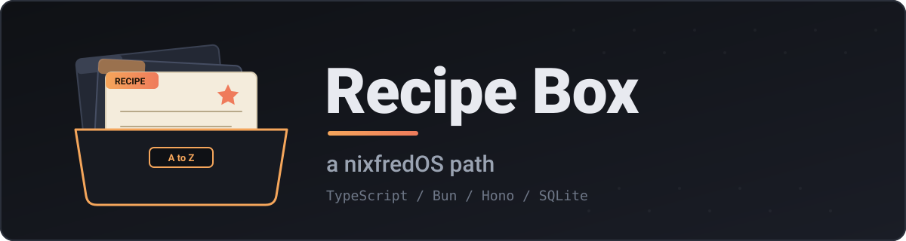
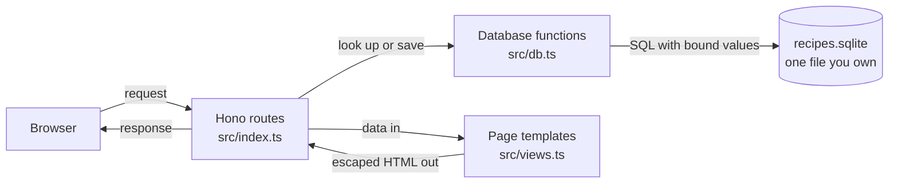

Start here: https://how.nixfred.com/recipe-box. One paste and your agent does the rest.

<p align="center">
  
</p>

<p align="center">
  
  
  
  
  
  
</p>

# Recipe Box

You build a recipe box web app, and your own Claude Code agent teaches you every step of it. It stops after each stage, explains the why, and waits for you. Nothing is hidden, nothing is magic, and nobody builds it for you.

This is a **path repo**: a GitHub template that turns the agent you already built into a patient teacher for one real project.

## What you get

Three things, in this order of importance:

1. **A finished recipe box app, running on your computer.** Add, edit, and delete recipes, search them, filter by tag, star your favorites. Your recipes live in one SQLite file that you own.
2. **Your agent, with a track record.** It has now taught and built something real with you, in small stages with checks, commits, and a progress file. That is how you will work with it from here on.
3. **Understanding of how both work.** What a web server is, what a database is, why forms redirect, why text must be escaped, why tests exist. You will be able to explain each one in your own words.

## What you need

- **Claude Code with your own agent.** If you have not built one yet, start at [how.nixfred.com](https://how.nixfred.com).
- **Bun.** If it is missing, your agent will show you the install options and ask before running anything.
- **A terminal**, and the [GitHub CLI](https://cli.github.com) (`gh`) signed in to your account. (You can use the green "Use this template" button on GitHub instead.)
- **Time.** A few hours, spread over one or two sittings. Each stage stops for you, so you set the pace.
- **macOS or Linux.** Built for macOS on Apple Silicon and for Omarchy (Arch Linux with Hyprland). Other Linux distributions should work the same way.

## Doing it by hand

If you would rather do it yourself, use the GitHub CLI:

```bash
gh repo create my-recipe-box --template nixfred/path-recipe-box --private --clone
cd my-recipe-box
claude
```

Then say:

> start the recipe box path

Your agent reads `CLAUDE.md`, opens `steps/01-setup.md`, tells you the goal in plain words, and begins.

## The journey

```mermaid
flowchart LR
    A["01 Setup"] --> B["02 Hello server"]
    B --> C["03 Database"]
    C --> D["04 JSON API"]
    D --> E["05 Pages"]
    E --> F["06 Forms"]
    F --> G["07 Search, tags, favorites"]
    G --> H["08 Tests"]
    H --> I["09 Style and polish"]
    I --> J["10 Make it yours"]
    J --> K(["Your app, your agent, your understanding"])
```



At every arrow the agent stops, shows you the result of a check, and asks whether you have questions or are ready to continue.

## What you are building



Three small source files, one stylesheet, one database file. No frontend framework, no build step.

## The stages

| # | Stage | What you learn |
|---|-------|----------------|
| 01 | [Setup](steps/01-setup.md) | Bun, a project folder, git commits, and a progress file |
| 02 | [Hello server](steps/02-hello-server.md) | Requests and responses, routes, ports, live reload |
| 03 | [The database](steps/03-database.md) | Tables and rows, why SQLite is a file you own, seeding |
| 04 | [The JSON API](steps/04-api.md) | CRUD, input checking, status codes, and SQL injection |
| 05 | [Pages](steps/05-pages.md) | Server rendered HTML, templates, and why text must be escaped (XSS) |
| 06 | [Forms](steps/06-forms.md) | POST, redirect, GET, and keeping what the person typed |
| 07 | [Search, tags, favorites](steps/07-search-tags-favorites.md) | GET versus POST, whole tag matching, safe redirects |
| 08 | [Tests](steps/08-tests.md) | `bun test`, temporary databases, testing routes without a network |
| 09 | [Style and polish](steps/09-style-and-polish.md) | CSS variables, responsive layout, focus, print, empty states |
| 10 | [Make it yours](steps/10-make-it-yours.md) | Safe backups, keeping it running, ideas to extend, a recap |

Every step file has the same four sections: **Goal**, **Build**, **Why**, **Check**.

## Repo layout

```
README.md          this file
CLAUDE.md          the rules your agent follows on this path
PROGRESS.md        created in step 01, updated after every stage
assets/            the banner
steps/             01-setup.md ... 10-make-it-yours.md
app/               YOUR build goes here (empty at the start)
reference/         the finished answer key (your agent only looks if stuck)
checks/            check.ts, the stage checker
```

When you finish, `app/` looks like this:

```
app/
  src/index.ts     routes: the JSON API and the pages
  src/db.ts        database: schema, seed data, queries
  src/views.ts     HTML templates
  public/style.css one small stylesheet
  tests/           bun test suites
  scripts/         backup script
  package.json
```

## How the checks work

After each stage your agent runs:

```bash
bun checks/check.ts <stage>
```

For example `bun checks/check.ts 4`. The checker starts your app on a free port with a throwaway database, runs the checks for every stage up to the one you named, and prints a PASS or FAIL for each. Every FAIL comes with a hint. When it finishes it stops the server and deletes the throwaway database, so your real recipes are never touched. It exits with an error code if anything failed.

Use `--dir reference` to run the same checks against the answer key:

```bash
bun checks/check.ts 10 --dir reference
```

## The answer key

`reference/` is a complete, working version of the app. It exists so the checks can be proven, and so a stuck agent has somewhere to look. The agent is told not to copy from it unless you ask, or it has failed twice. You are free to read it any time you like. To run it:

```bash
cd reference
bun install
bun run dev
```

## Make it yours

You can change anything. If you want a different name, different fields, or a feature that is not here, tell your agent. It will help you, and note the difference from the plan in `PROGRESS.md` so a new session knows what you did.

---

Part of nixfredOS. Free plus your Claude subscription. Don't trust me, audit it.
